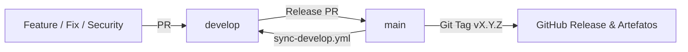

# Versionamento Semântico e Processo de Releases

Este documento formaliza o processo de versionamento, governança de branches, critérios de compatibilidade, geração de pacotes distribuíveis e assinatura criptográfica de artefatos no projeto **KSC Deployment Runbook**.

---

## 1. Princípios de Semantic Versioning (SemVer 2.0.0)

O projeto adota estritamente o padrão [Semantic Versioning 2.0.0](https://semver.org/lang/pt-BR/). Todas as versões públicas são identificadas pelo formato de tag:

```
v<MAJOR>.<MINOR>.<PATCH>
```

Exemplo: `v2.0.0`, `v2.1.0`.

### Critérios de Incremento

- **MAJOR (Quebra de Compatibilidade / Mudança Arquitetural)**:
  - Alteração do sistema operacional base suportado (ex: Rocky Linux 9 para Rocky Linux 10 ou Debian).
  - Mudança de versão maior do Kaspersky Security Center com incompatibilidade de contratos ou comandos (ex: KSC 16 para KSC 17).
  - Reestruturação de argumentos ou comportamento da CLI `kscctl` que quebre automações existentes (ex: transição de `--apply` simulado para instalação real na v2.0.0).
  - Alteração da versão mínima do interpretador Python (ex: Python 3.9 para 3.11).
- **MINOR (Novas Funcionalidades e Extensões Compatíveis)**:
  - Novos comandos ou subcomandos na CLI `kscctl` (ex: suporte a novos modos de rollback, inspeção de tokens).
  - Adição de novos playbooks ou módulos auxiliares sem quebra de compatibilidade.
  - Validação e comprovação de novo sistema operacional ou SGBD em laboratório E2E.
- **PATCH (Correções de Bugs, Segurança e Documentação)**:
  - Correção de bugs em scripts existentes (`setup_steps.py`, `checks.py`).
  - Remediações de segurança, correções em regras de firewall ou permissões de arquivos.
  - Atualização e expansão de manuais e runbooks em `docs/`.

---

## 2. Governança de Branches e Promoção de Releases

O fluxo de publicação segue rigorosamente o modelo DevSecOps do repositório:



1. **Desenvolvimento Contínuo**:
   - Todo desenvolvimento é realizado em branches `feat/*`, `fix/*`, `security/*`, `docs/*` ou `chore/*`.
   - **Todo Pull Request deve ter como base a branch `develop`**.
2. **Promoção para `main` (Release PR)**:
   - Releases são preparadas na branch `develop` mediante atualização do `CHANGELOG.md` e validação da suíte de testes.
   - Um **Release PR** é aberto de `develop` para `main`.
   - Apenas o Code Owner (`@mendsec`) possui permissão de aprovação e merge na branch `main`.
   - O merge **NUNCA utiliza squash**, preservando o histórico e assinaturas criptográficas dos commits (`--merge` ou `--rebase`).
3. **Criação da Tag de Release**:
   - As tags de versão são geradas exclusivamente a partir da branch `main`.
   - Todas as tags **DEVEM ser assinadas criptograficamente**:
     ```bash
     git tag -s v2.1.0 -m "Release v2.1.0 — Remediações de segurança e governança"
     git push origin v2.1.0
     ```
4. **Sincronização Reversa**:
   - O workflow `sync-develop.yml` sincroniza automaticamente a branch `main` com `develop` após o merge.

---

## 3. Matriz de Compatibilidade Declarada por Release

Um dos pilares do projeto é a **honestidade técnica e separação categórica entre ambientes comprovados e ambientes teóricos**.

A cada nova release, o mantenedor DEVE declarar explicitamente em `CHANGELOG.md` e nas notas de versão:

| Categoria | Definição | Critério de Aceite |
|---|---|---|
| **Comprovado em Execução Real** | Combinação de SO, KSC e SGBD testada de ponta a ponta em laboratório real com evidências brutas armazenadas em `evidence/`. | Deploy real concluído com exit 0, Web Console respondendo HTTP 200, postcheck aprovado e 12 serviços ativos. |
| **Declarado em Documentação** | Combinações suportadas teoricamente pela Kaspersky e pela arquitetura, mas que ainda não passaram por validação E2E no laboratório Proxmox. | Declaradas com ressalva explícita de validação pendente (ex: Issue #227 para Oracle Linux 9). |

> **Invariante**: É proibido promover um sistema operacional ou versão de produto para o status "Comprovado" baseado apenas em inferência documental.

---

## 4. Artefatos Distribuíveis e Integridade (`SHA256SUMS`)

Para usuários e administradores que operam em redes corporativas isoladas e não desejam ou não podem clonar todo o histórico Git do repositório, cada release disponibiliza um pacote distribuível limpo.

### 4.1 Geração de Pacote Limpo

O utilitário `scripts/package_release.py` empacota a release garantindo:
- Inclusão dos módulos de automação (`automation/`), documentação operacional (`docs/`), dependências (`requirements.txt`), contratos de CLI e licença.
- Exclusão estrita de histórico Git (`.git/`), suítes de teste de desenvolvimento (`tests/`), logs brutos (`evidence/`), caches (`__pycache__/`, `.venv/`), segredos ou rascunhos (`.secrets.baseline`, `scratch/`).

Execução do empacotamento:
```bash
python scripts/package_release.py --version v2.1.0 --output-dir dist
```

Arquivos gerados em `dist/`:
- `ksc-deployment-runbook-v2.1.0.tar.gz`: Arquivo compactado distribuível.
- `SHA256SUMS`: Manifesto de hashes SHA-256 de todos os artefatos gerados.

---

## 5. Assinatura Criptográfica e Verificação

A integridade e autenticidade de toda release são garantidas por meio de assinaturas digitais criptográficas.

### 5.1 Assinatura pelo Mantenedor (OpenSSH ou GPG)

A assinatura do manifesto `SHA256SUMS` é gerada com a chave SSH ED25519 do mantenedor:

```bash
# Assinatura via SSH
ssh-keygen -Y sign -f ~/.ssh/id_ed25519 -n file dist/SHA256SUMS
# Gera o arquivo dist/SHA256SUMS.sig
```

Ou através do utilitário de empacotamento:
```bash
python scripts/package_release.py --version v2.1.0 --output-dir dist --sign-key ~/.ssh/id_ed25519
```

### 5.2 Verificação pelo Operador / Adotante

Antes de descompactar e executar o runbook em servidores corporativos, o operador pode validar a integridade e autenticidade dos artefatos:

1. **Verificação do Hash SHA-256**:
   ```bash
   sha256sum -c SHA256SUMS
   # Deve retornar: ksc-deployment-runbook-v2.1.0.tar.gz: SUCESSO (OK)
   ```

2. **Verificação da Assinatura SSH**:
   Crie um arquivo de signatários autorizados (`allowed_signers`):
   ```text
   fabiomendesilva@gmail.com ssh-ed25519 AAAAC3NzaC1lZDI1NTE5AAAAIHR7...
   ```
   Execute a verificação criptográfica:
   ```bash
   ssh-keygen -Y verify -f allowed_signers -I fabiomendesilva@gmail.com -n file -s SHA256SUMS.sig < SHA256SUMS
   # Saída esperada: Good "file" signature for fabiomendesilva@gmail.com with ED25519 key...
   ```

---

## 6. Automação de Publicação via GitHub Actions

O repositório possui o workflow [.github/workflows/release.yml](.github/workflows/release.yml), que executa os seguintes passos ao detectar o push de uma nova tag `v*.*.*` ou disparo via `workflow_dispatch`:

1. Checkout do código e configuração do ambiente Python 3.11.
2. Execução da suíte completa de testes (`pytest -v`).
3. Validação de ausência de segredos (`detect-secrets scan`).
4. Geração do arquivo compactado `.tar.gz` e do manifesto `SHA256SUMS` via `scripts/package_release.py`.
5. Extração das notas de release diretamente da seção correspondente em `CHANGELOG.md`.
6. Publicação oficial do release no GitHub (`gh release create`), anexando os binários compactados e hashes de integridade.

---

## 7. Checklist de Publicação (Runbook do Mantenedor)

Antes de publicar qualquer release:

- [ ] A suíte de testes passa com 100% de sucesso localmente (`python3 -m pytest`).
- [ ] O scan de segredos não detecta nenhuma divergência (`detect-secrets scan --baseline .secrets.baseline`).
- [ ] O arquivo [CHANGELOG.md](CHANGELOG.md) foi atualizado:
  - Movidas as alterações de `[Unreleased]` para `[vX.Y.Z] — AAAA-MM-DD`.
  - A matriz de compatibilidade real foi explicitada nas notas da versão.
- [ ] O Release PR de `develop` para `main` foi aprovado e integrado com standard merge (`gh pr merge --merge`).
- [ ] A tag assinada foi criada na branch `main` (`git tag -s vX.Y.Z -m "..."`).
- [ ] A tag foi enviada ao GitHub (`git push origin vX.Y.Z`), acionando o workflow `release.yml`.
- [ ] O release no GitHub foi validado contendo o tarball, notas e manifesto `SHA256SUMS`.
